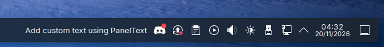

# PanelText

A simple KDE Plasma 6 widget that displays custom text in the panel.



## Requirements

- KDE Plasma 6

> **Important:** This widget has only been tested on KDE Plasma 6.8. Other
> Plasma versions will probably work, but they are not currently verified. If you use this on any other version, please let me know the results.

> **Disclaimer:** While this widget is simple in design, it is provided as-is, without warranties or guarantees. Use it at your own risk.

## Installation

### 1. Download PanelText

Open a terminal and run:

```bash
git clone https://github.com/ameysh/PanelText.git
```

Then enter the downloaded folder:

```bash
cd PanelText
```

### 2. Install the widget

Run:

```bash
kpackagetool6 --type Plasma/Applet --install package
```

### 3. Add PanelText to your panel

1. Right-click an empty area of your panel.
2. Select **Add Widgets**.
3. Search for **PanelText**.
4. Drag it onto your panel.
5. Exit edit mode.

If PanelText does not appear immediately, log out and back in, then check the widget list again.

## Configuration

1. Right-click the PanelText widget.
2. Select **Configure PanelText**.
3. Enter the text you want to display.
4. Select **Apply** or **OK**.

## Uninstallation

Open a terminal, enter the PanelText folder, and run:

```bash
kpackagetool6 --type Plasma/Applet --remove com.github.ameysh.paneltext
```

You can then delete the downloaded `PanelText` folder if you no longer need it.